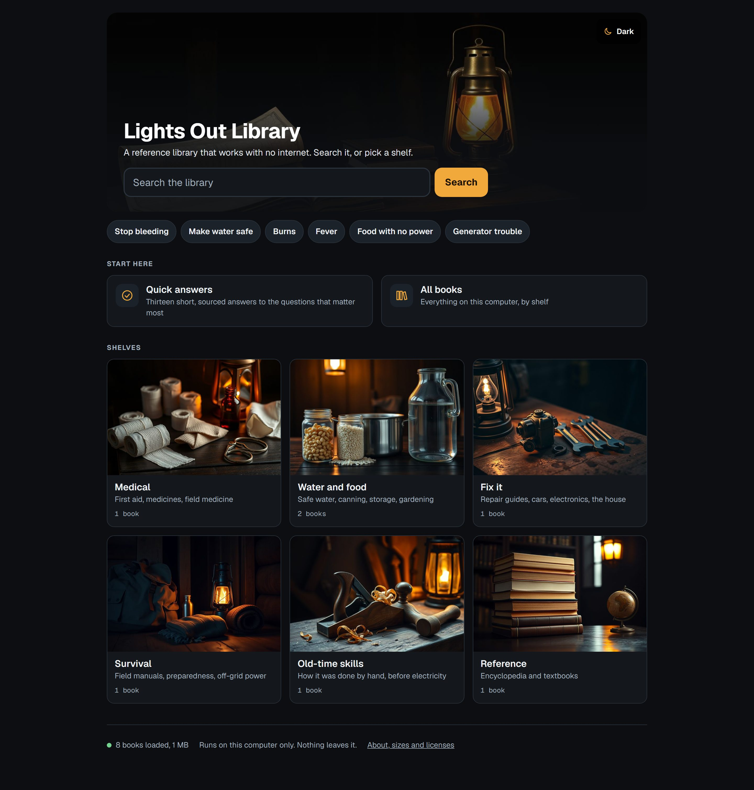

# Lights Out Library

> An offline survival and reference library that runs on one laptop, with no internet, in 500 GB or less.

**Status:** first working version, 2026-11-10. Runs on Windows; Linux and macOS start scripts are written but not yet run on those systems.
**Made by:** Jaxson Pierce Solutions LLC · **License:** MIT, open source



## What it is

When the power or the internet is out, the answers people need are still
simple ones: how to stop bleeding, make water safe, keep food, fix a
generator. This puts a searchable library of that material on a laptop
ahead of time:

- **Search** across medical references, field manuals, repair guides,
  food and water guides and an encyclopedia.
- **Quick answers**: thirteen short, sourced answers to the questions that
  matter most. They work even with no books loaded.
- **Shelves** for Medical, Water and food, Fix it, Survival, Old-time skills
  and Reference.
- **Ask** (optional, off by default): a small AI model on the same laptop
  reads the library and answers with its sources.
- **Your own files**: music, films and documents you put in the `files/` folder, played in the page.
- **Add-on layers**: your own pages and home-page cards (a stock list, local maps, a printed
  sheet) kept in a private folder of your own. See [docs/layers.md](docs/layers.md).
- Three themes: Dark and Light (the shared Jaxson Pierce Solutions look) and a red Night theme that keeps your night vision.

It serves pages to `127.0.0.1` only. Nothing on the page loads from the
internet, and a test fails if anything tries.

## This repo holds no books

The repo is the pages, the scripts and a manifest. The books are downloaded
by each person, from the official Kiwix site, with the fetch script.
`manifest/content.json` lists every book's source, exact size and license;
[docs/licenses.md](docs/licenses.md) explains what that means if you ever
want to hand out or sell a loaded drive. Short version: don't, without
reading it.

## The sets

Each set includes the ones above it. Sizes were added up from the source
files on 2026-11-10.

| Set | Size | Books | What it's for |
|---|---|---|---|
| **Pocket** | 8.2 GB | 16 | A thin laptop or a small drive. First aid, medicines, safe water, food storage, knots, the first weeks. |
| **Essentials** | 33.9 GB | 34 | Most laptops. Adds field manuals, repair guides, an illustrated encyclopedia, gardening, off-grid power, animal care. |
| **Full** | 115.5 GB | 40 | Room to spare. Adds every Wikipedia article (text), open textbooks, electronics, two shelves of old how-to books. |
| **Archive** | 335.8 GB | 41 | An external drive. Adds 220 GB of scanned pre-1930s books that can only be browsed by title. |

The tools add 0.02 GB and the optional AI about 5.2 GB, so the largest set
with everything turned on is about 341 GB. Six extras (Wikipedia with
pictures, five video sets) can be added one at a time; the fetch script
refuses anything that would pass 500 GB.

## What you need beforehand

| Need | Why | Get it |
|---|---|---|
| **Python 3.9 or newer** | Runs the fetch and start scripts. No extra packages. | python.org, the Microsoft Store, or your Linux package manager. macOS: `xcode-select --install` or python.org. |
| **A browser** | Shows the pages. | Any current one. |
| **Internet, once** | To download the books. | Not needed after that. |
| **Free disk space** | See the table above. | An external SSD works. |
| *Optional:* Ollama and a model | Only for Ask. | ollama.com, then see "Ask" below. |

The fetch script downloads the one other program, `kiwix-serve` (the book
server, GPL 3.0), from Kiwix for your system.

## Get it running

1. **Download** the latest zip from [Releases](https://github.com/JaxsonPierceSolutions/lights-out-library/releases/latest)
   (or `git clone` this repo) and unzip it anywhere, an external drive included.
2. **Install Python 3.9 or newer** if you don't have it (see the table above).

Then, while you have internet:

```
fetch --list             show the sets and sizes        (Linux/macOS: ./fetch.sh --list)
fetch --tier pocket      download a set and the book server
```

Then, any time, with or without internet:

```
start                    Windows: double-click start.cmd    (Linux/macOS: ./start.sh)
```

It opens `http://127.0.0.1:8600/` in your browser. Close the window it
started in to stop it.

Downloads resume if they are interrupted, and every file is checked
against the SHA-256 that Kiwix publishes. `fetch --verify` re-checks what
you have.

## Ask (optional)

Off by default. To turn it on: install Ollama, pull one model and the
embedding model, then copy `config.example.json` to `config.json` and set
`ask.enabled` to `true` and `ask.model` to the model's name.

| Model | Made by | License | Size | Tried with this project |
|---|---|---|---|---|
| `granite3.3:8b` | IBM (US) | Apache-2.0 | 4.9 GB | Not yet |
| `mistral:7b` | Mistral AI (France) | Apache-2.0 | 4.4 GB | Not yet |
| `llama3.1:8b` | Meta (US) | Llama 3.1 Community License | 4.9 GB | Yes, by the maintainers |

Plus `nomic-embed-text` (Nomic AI, US, Apache-2.0, 0.3 GB). The project
names no default model. DeepSeek models are refused by the config check.
Ask can be wrong; the page says so and shows the pages it read.

## What was left out, and why

- **Anything about one household:** stock lists, photos, addresses,
  equipment, regional maps, charts and a local plants page.
- **Movies and music:** personal files nobody else can legally download.
- **TruePrepper and Low-Tech Magazine:** no license that lets Kiwix users
  copy them could be confirmed.
- **Old medical books:** century-old treatments, easy to mistake for advice.

## Repo map

| Path | What |
|---|---|
| `site/` | The pages, styles, fonts and pictures. Static files. |
| `src/lightsout/` | `server.py` (pages and book-server proxy), `fetch.py` (downloads), `ask.py` (optional AI), `askserve.py` (Ask on its own), `build.py` (static files for a web server), `layers.py` (add-on layers). Standard library only. |
| `deploy/` | An example web server setup for a built library. |
| `manifest/content.json` | Every book: source, size, license, set, shelf. |
| `art/` | The two best pictures for each slot, with the prompt that made each. |
| `tests/` | Server, fetch, manifest and page tests, and a browser test that fails on any outside request. |
| `DESIGN.md` | How the pages should look and read. |
| `docs/` | Licenses, decisions, screenshots. |

## On a home server instead of one laptop

`python -m lightsout.build --out dist --layer DIR` writes the pages as plain files for a web
server such as nginx, with your layers applied. `python -m lightsout.askserve` runs Ask beside
it. [docs/layers.md](docs/layers.md) and [deploy/nginx.example.conf](deploy/nginx.example.conf)
show how. The library has no logins, so only do this on a network you trust.

## Checks

```
python -m pytest tests -q            every test, including the browser test
```

The browser test needs `pip install playwright` and `playwright install chromium`.
Those are test tools only; the library itself needs neither.

## Credits

Created by **Jaxson Pierce Solutions**. Contributions welcome: see [CONTRIBUTING.md](CONTRIBUTING.md).
Security problems: see [SECURITY.md](SECURITY.md).

MIT license (see `LICENSE`) for the code, pages and pictures. The books are not ours; each keeps
its own license, see [docs/licenses.md](docs/licenses.md).

## Disclaimer

This is a reference library, not medical, legal or safety advice, and it comes with no
warranty. The Quick answers were written by an AI system from the public guidance each one
names; no doctor or nurse has reviewed them. Books can be out of date or wrong. If you can
reach real help, do.
